

  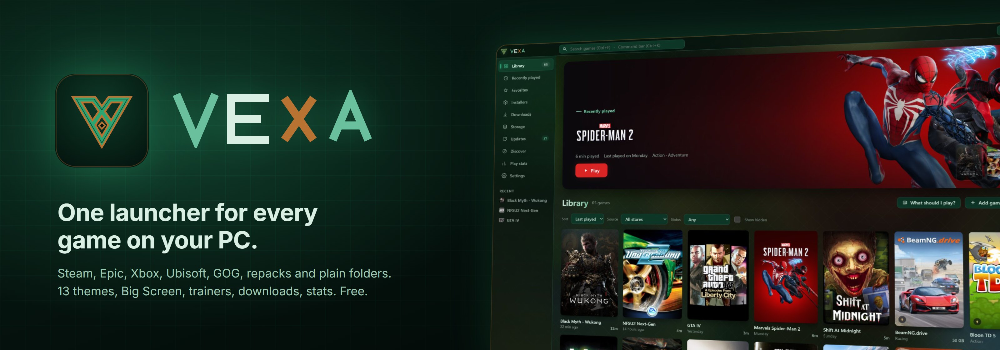

  

  
  
  
  

  <b>Steam, Epic, Xbox, Ubisoft, GOG, repacks and plain folders, in one fast library.</b> 
  13 themes, a TV mode with real game cases, trainers, downloads, recording and your year in games.

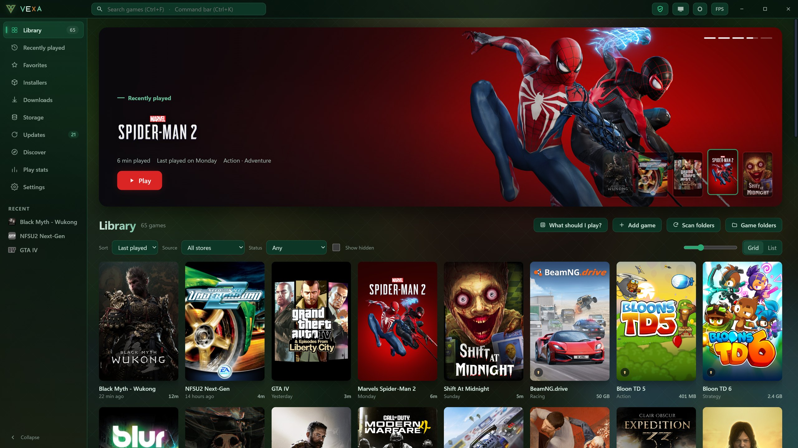

Point at a game and its trailer plays on the cover while the page takes on the game's colours.

## 13 themes, and you can make your own

Every theme has its own logo, heading font, corners and background pattern. Then mix and match: any logo with any theme, 12 fonts, moving backgrounds, or your own picture or video.

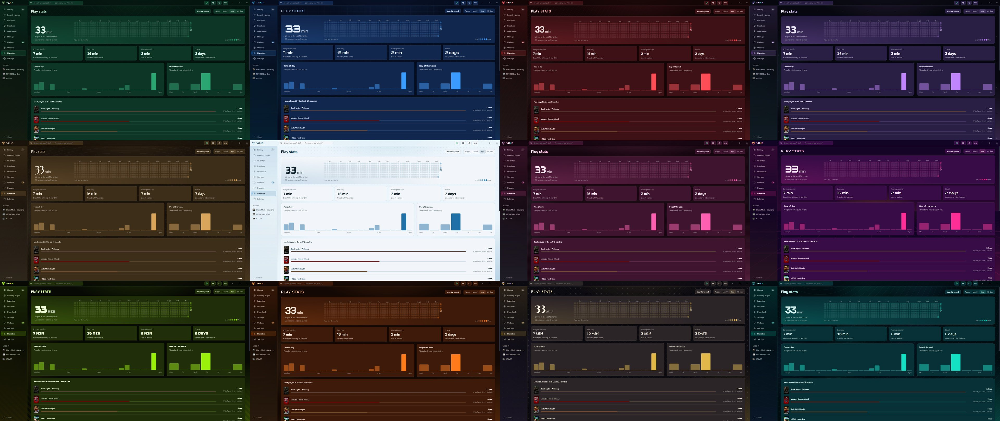

<table>
  <tr>
    <td width="33%">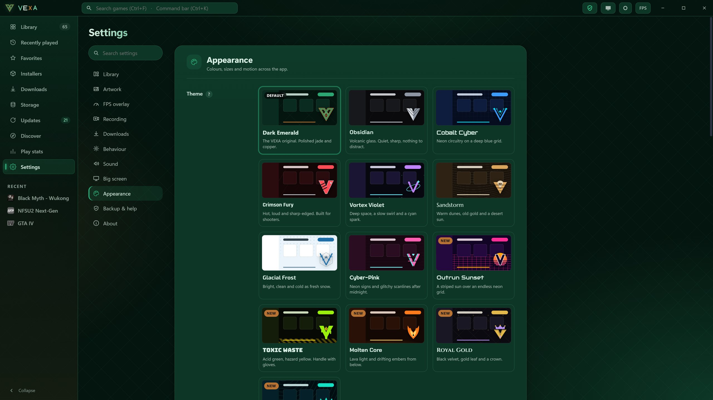</td>
    <td width="33%">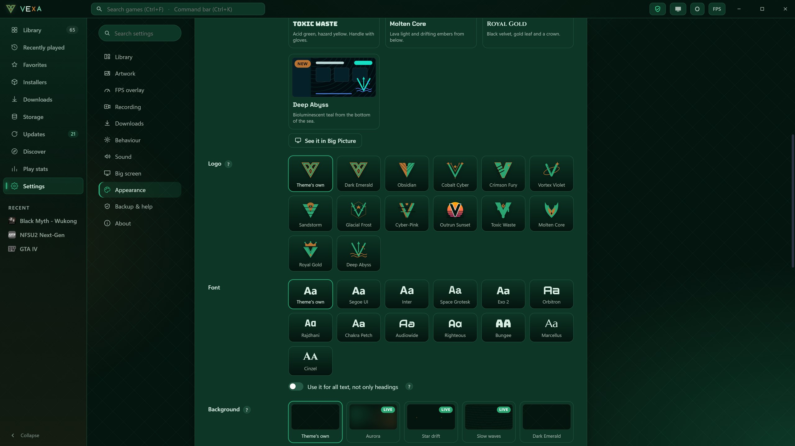</td>
    <td width="33%">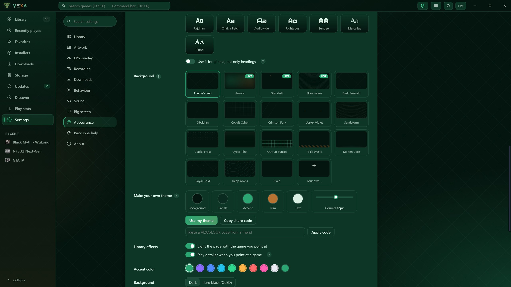</td>
  </tr>
  <tr>
    <td align="center"><b>Pick a theme</b> Point at one to see the whole app in it</td>
    <td align="center"><b>Any logo, any font</b> 13 logos in your colours, 12 fonts</td>
    <td align="center"><b>Make your own</b> Five colours, live preview, share it as a code</td>
  </tr>
</table>

## Big Screen for your TV and controller

Twelve layouts, from simple rows to a shelf of real 3D game cases with printed spines. Press Play and the case swings open and lifts the disc out. Music, sounds, downloads and recording all work with the controller.

<table>
  <tr>
    <td>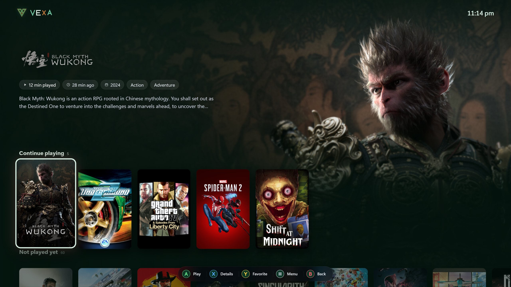</td>
    <td>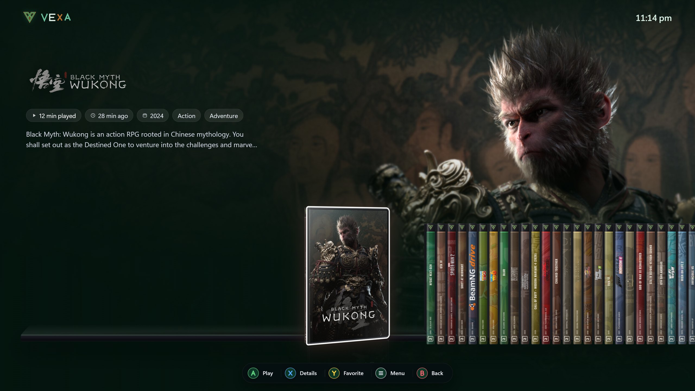</td>
  </tr>
  <tr>
    <td align="center"><b>Rows</b></td>
    <td align="center"><b>Case shelf</b></td>
  </tr>
</table>

## Game pages and trainers

Every game gets its own page in its cover's colours, with trailers, screenshots, music, playtime and its launch settings. Free single-player trainers from FLiNG and MrAntiFun are found for you and run from the game page: hidden in the background, started and closed with the game, and your switches set by themselves once you're in the game.

<table>
  <tr>
    <td width="62%">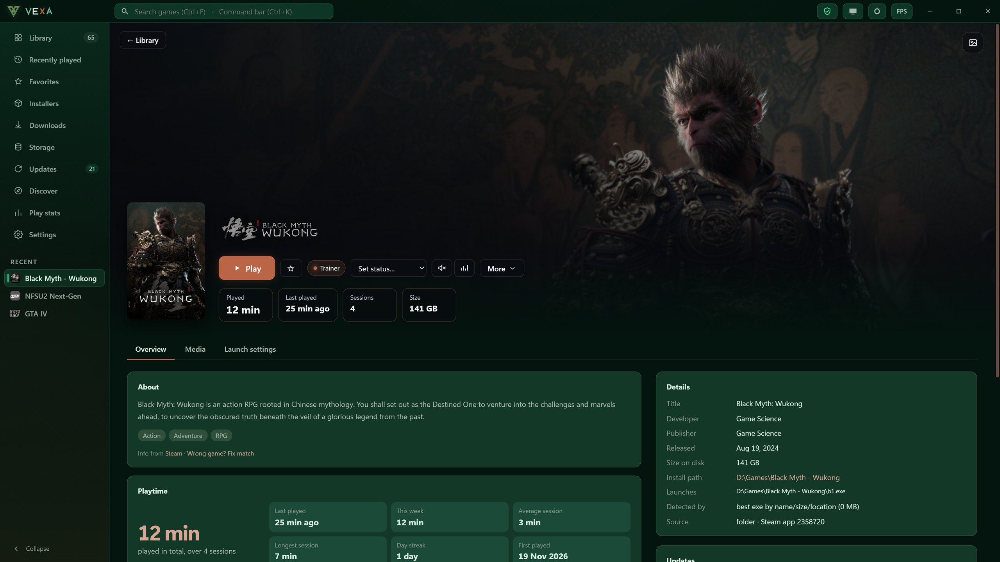</td>
    <td width="38%">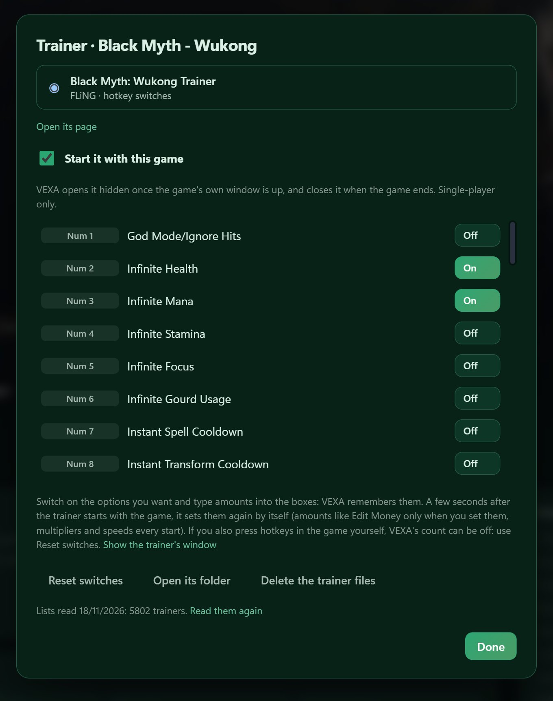</td>
  </tr>
  <tr>
    <td align="center"><b>Game page</b></td>
    <td align="center"><b>Trainer switches</b></td>
  </tr>
</table>

## Discover

New releases and repacks from FitGirl, DODI, Online-Fix, SteamRIP, ElAmigos and your own sources in one store. One big search with results as you type, crack status, a wishlist and a Download button on every card.

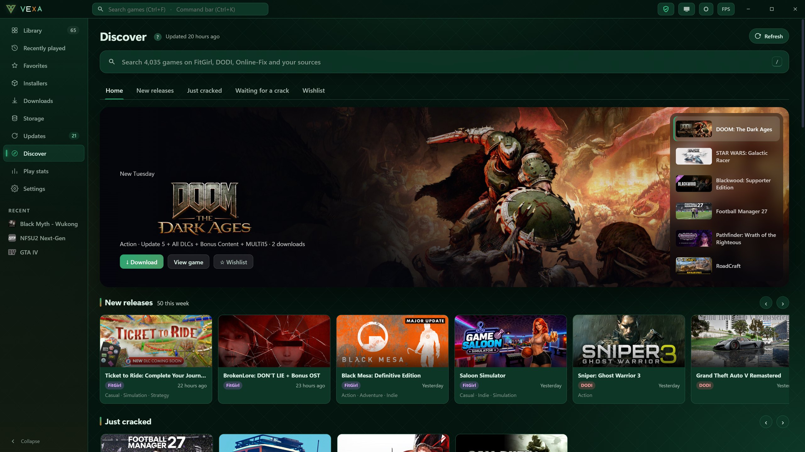

## Play stats and VEXA Wrapped

<table>
  <tr>
    <td width="64%">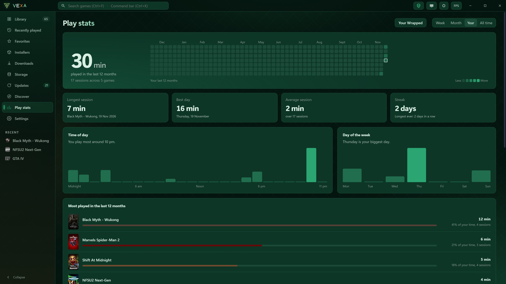</td>
    <td width="36%">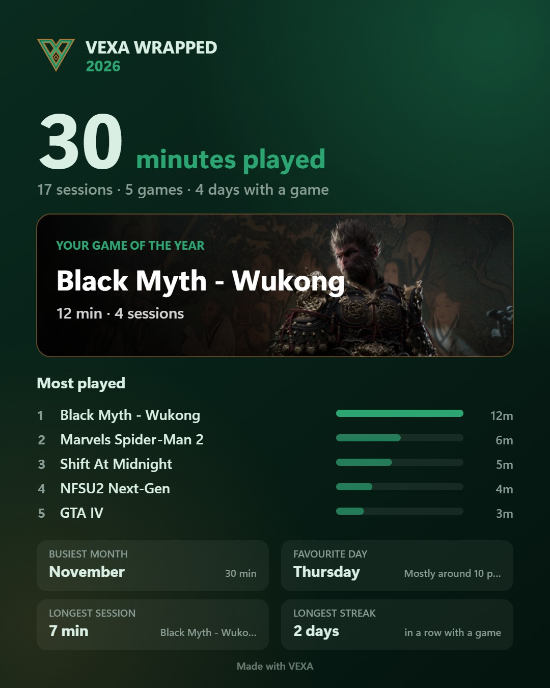</td>
  </tr>
  <tr>
    <td align="center"><b>Play stats</b> A year of play, time of day, streaks, most played</td>
    <td align="center"><b>VEXA Wrapped</b> Your year in games on one card to save or share</td>
  </tr>
</table>

## Everything VEXA does

**Library**
- Finds your games from Steam, Epic, Xbox, Ubisoft, GOG, EA, Battle.net, Amazon, itch.io, repacks and plain folders, with covers, logos, backgrounds, descriptions and playtime.
- Trailers play on the cover when you point at a game, and the Library lights up in that game's colours.
- Recently played banner, favourites, statuses, hidden games, grid or list, and "What should I play?".
- Art picker with HD and 4K covers, logos and backgrounds (SteamGridDB optional), and highest-resolution art if you want it.
- Command bar on Ctrl+K and search on Ctrl+F.

**Game pages**
- The page wears the cover's colours, with up to seven trailers, a gameplay video, screenshots and the game's music.
- Playtime, sessions, streaks and a calendar of when you played.
- Launch settings: arguments, run as admin, mute while playing, and Lossless Scaling per game (scaling, 2x to 4x frame generation).
- Save backups, "where I left off" notes, and one-click version checks.
- Before a game starts, VEXA checks what it needs (Visual C++, DirectX, .NET, XNA, PhysX, OpenAL) and installs anything missing from Microsoft.

**Trainers**
- Free single-player trainers from FLiNG and MrAntiFun, matched to your game and downloaded in one click.
- A switch for every option, and number boxes for amounts like game speed or damage multiplier.
- The trainer starts hidden with the game and closes with it. Your switches and amounts are set again by themselves once the trainer is ready.

**Look and feel**
- 13 themes, each with its own logo, font, corners and background pattern, in a Vivid or Calm style.
- Any logo with any theme, 12 fonts, moving backgrounds (Aurora, Star drift, Slow waves), or your own picture or video.
- Make your own theme from five colours and share the whole look as a code.
- Six sidebar styles, left or right, comfortable or compact.
- The VEXA icon on the taskbar, tray and shortcuts follows your theme.

**Big Screen**
- A TV and controller mode with 12 layouts, including real 3D game cases that open when you press Play.
- Follows the app's theme, with music, menu sounds, volume bars and its own Downloads page.

**Discover and downloads**
- One store for new releases, just cracked, waiting for a crack and your wishlist, with crack and Denuvo status.
- Download sources work like Hydra: FitGirl, DODI, Online-Fix, SteamRIP and ElAmigos are set up for you and refresh daily, and you can add more.
- Direct links, torrents and magnets in the app, with Real-Debrid, AllDebrid, Premiumize and TorBox.
- "Get the best pick" chooses the best release for you. Pick which files of a torrent to get.
- Hosts like Gofile, PixelDrain, filecrypt and FileDitch work inside VEXA, plus Click'n'Load.
- Queue, speed and upload limits, resume, seeding, and a VPN kill switch.
- Finished downloads extract (7-Zip included) and install on their own, one after another, with the files checked after.

**Updates**
- Official patch notes for your games, and new releases from every source.
- Update a game in one click: saves are backed up first and the new version only replaces the old one once it's ready.
- Graphics driver check for NVIDIA and AMD.

**Recording and overlay**
- Screen recorder (Alt+Shift+R) and instant replay of the last 30 seconds to 5 minutes (Alt+Shift+S), on NVIDIA, AMD and Intel.
- Clips show on each game's Media tab.
- FPS overlay with its own hotkey, layouts and RivaTuner support, so it shows in your recordings too.

**Stats**
- Play stats for the week, month, year or all time: time of day, day of the week, longest session, streaks and most played.
- VEXA Wrapped: your year in games on one card to save or copy.

**Everyday**
- Storage view of every game's size, and Recycle Bin for anything VEXA removes.
- Start with Windows, close to the tray, and an optional admin mode for games that need it.
- A "What's new" window after every update, and the full history in Settings.

## Lightweight

Measured on Windows 11 (Intel i5-14600K, RTX 5080, 64 games in the library), VEXA plus its web view:

| | RAM in use | CPU (whole PC) |
|---|---|---|
| **Min:** closed to the tray, even right after heavy use | about 108 MB | 0.01% on average |
| **Max:** heavy use: trailers playing, Discover, game pages, Big Screen animations | 1.0 GB at the peak (770 MB on average) | 9.7% at the peak (5% on average) |

When you close the window, VEXA pauses its page and hands its memory back to Windows. In the background it only keeps the tray icon, playtime tracking and a light hourly refresh of your download sources.

## Download and install

1. Download **VEXA-Setup-&lt;version&gt;.exe** from the [latest release](https://github.com/CyberRetr0/VEXA-releases/releases/latest).
2. Run it. It installs for your Windows user only.
3. VEXA updates itself: it checks for a new version every time it starts. You can turn automatic updates off in **Settings → About**.

## Safety

- Every update is signed. VEXA refuses any update whose signature does not match the key built into the app.
- Updates download only over HTTPS from this page.
- No accounts and no telemetry.
- VEXA contacts Steam, Wikipedia, PCGamingWiki, iTunes and SteamGridDB for art, descriptions, music and patch notes. Discover reads the public pages of the sources it lists. Downloads start only when you click.
- Trainers are for single-player games only, and VEXA only downloads them when you ask.
- Anything VEXA deletes goes to the Recycle Bin. Keys you enter (SteamGridDB, debrid) stay on your PC and are never exported.

## Problems or ideas

Open an [issue](https://github.com/CyberRetr0/VEXA-releases/issues), or use **Settings → Report a problem** in the app. It makes a zip of the logs you can attach.

  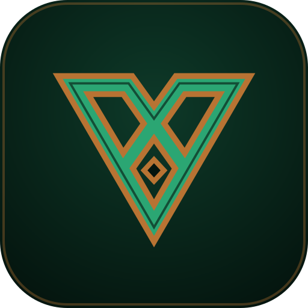 
  Made by Phant0m

