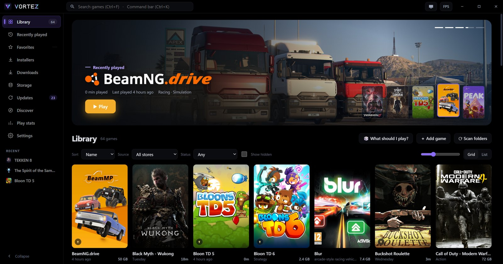
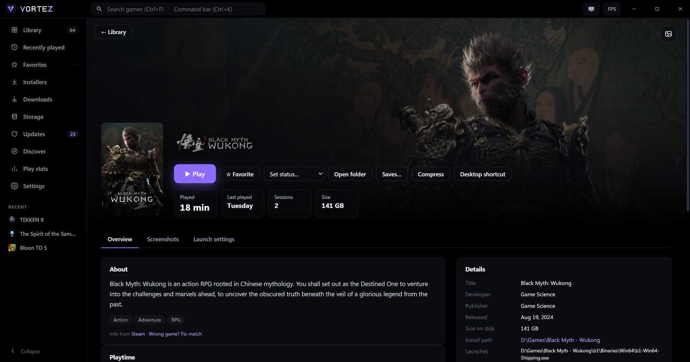
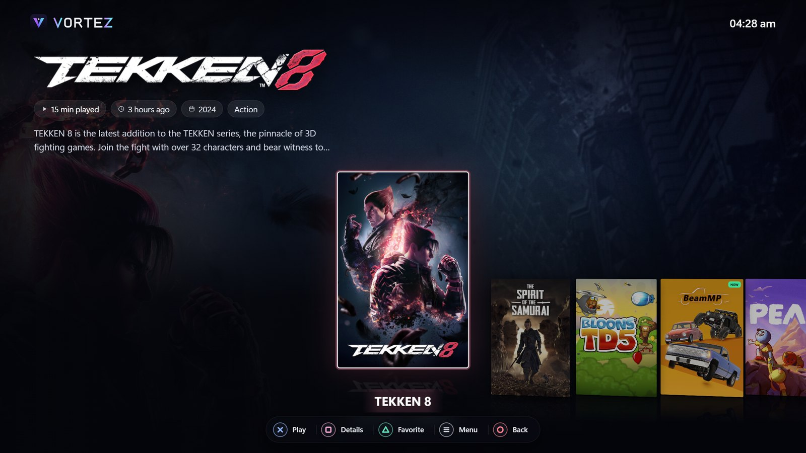
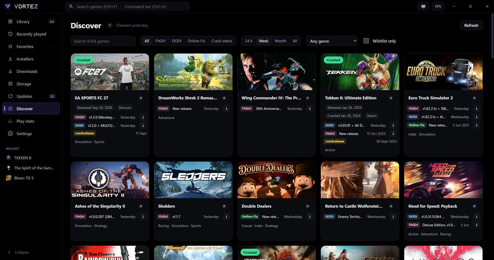

  

<h1 align="center">Vortez</h1>

  <b>One launcher for every game on your PC.</b> 
  Steam, Epic, Xbox, Ubisoft, GOG, repacks and plain folders, in one fast library.

  

  
  
  

## Features

- **One library:** finds your games from every store and folder, with covers, logos, descriptions and playtime.
- **Big screen mode:** a TV and controller interface with themes, layouts and sounds (F11 or the controller's View button).
- **Discover:** new releases and repacks from several sources, crack status, a wishlist, and a download button on every card.
- **Downloads:** direct links, torrents and magnets in the app, with queue, speed limit, resume and a VPN kill switch.
- **Installers and updates:** an install queue for setup files and archives, plus official patch notes for your games.
- **FPS overlay, storage view, play stats, save backups,** and a command bar on Ctrl+K.

<table>
  <tr>
    <td></td>
    <td></td>
  </tr>
  <tr>
    <td align="center">Game page</td>
    <td align="center">Big screen mode</td>
  </tr>
</table>

## Download and install

1. Download **[Vortez-Setup.exe](https://github.com/CyberRetr0/Vortez-releases/releases/latest/download/Vortez-Setup.exe)**.
2. Run it. It installs for your Windows user only and needs no admin rights.
3. Vortez updates itself: it checks for a new version every time it starts. You can turn automatic updates off in **Settings → About**.

## Safety

- Every update is signed. Vortez refuses any update whose signature does not match the key built into the app.
- Updates download only over HTTPS from this page.
- No accounts and no telemetry.
- Vortez contacts Steam, Wikipedia, PCGamingWiki, iTunes and SteamGridDB for art, descriptions, music and patch notes. Discover reads the public pages of the sources it lists. Downloads start only when you click.
- Anything Vortez deletes goes to the Recycle Bin. Keys you enter (SteamGridDB, debrid) stay on your PC and are never exported.

## Problems or ideas

Open an [issue](https://github.com/CyberRetr0/Vortez-releases/issues), or use **Settings → Report a problem** in the app. It makes a zip of the logs you can attach.

Made by Phant0m

